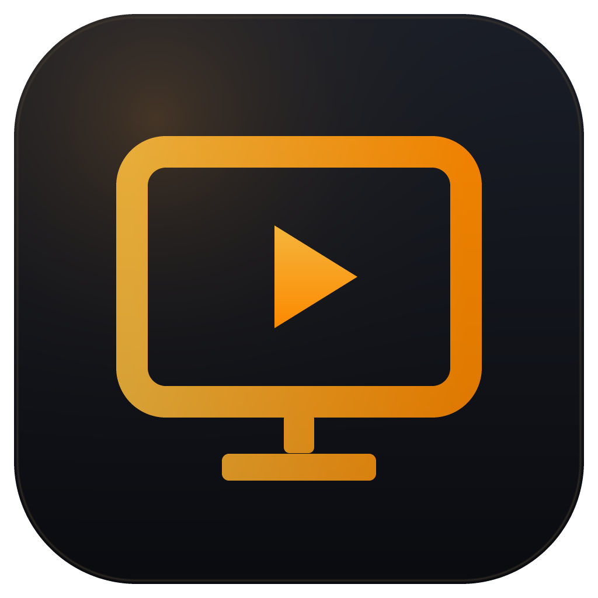

# TellyMote

A Windows desktop remote and live screen viewer for Android TV, built first for a **Xiaomi Mi TV 4A 43"**
(PatchWall / Android TV 9). Everything runs on your LAN: no account, no cloud relay, no telemetry.



> **Honest status:** verified on a real **Xiaomi Mi TV 4A 43" (`MiTV4I`, Android 9 / SDK 28)** over a
> private LAN: SSDP discovery, ATV v2 pairing and control, ADB authorisation, the live app list,
> and the PNG screenshot feed (real 1280×720 frames). The H.264 stream was confirmed to carry
> SPS/PPS/IDR and feed WebCodecs; the final "decoded frames paint" pass was cut short when the TV
> powered off. Rows in [docs/COMPATIBILITY.md](docs/COMPATIBILITY.md) are marked **verified** or
> **pending** individually — nothing unverified is presented as working. 149 automated tests cover
> the protocol and capture logic, including real TLS/TCP mock servers.

---

## What it does

| Area | Behaviour |
| --- | --- |
| **Discovery** | mDNS/DNS-SD (`_androidtvremote2._tcp`, `_googlecast._tcp`), SSDP/UPnP, active TCP probe of the local /24, and manual IP entry. Virtual adapters are deprioritised; saved devices reconnect without rediscovery. |
| **Pairing** | Android TV Remote v2 pairing (RSA client certificate, six-character code shown by the TV) and optional ADB authorisation. Every secret is explicit and cancellable. |
| **Remote** | D-pad, OK/select, back, home, menu, settings, volume, mute, play/pause, transport, channel keys, input, power, long-press, app deep links. Commands are throttled and measure their own round-trip time. |
| **Text input** | ADB text injection is the reliable path; TV IME injection is offered as experimental and only after the TV advertises the IME feature. |
| **Live screen** | (1) ADB H.264 elementary stream decoded with WebCodecs - true continuous video; (2) ADB PNG screenshot feed - explicitly labelled a **screenshot feed**, not video; (3) clear explanation when neither is possible. No fake frames, ever. Click-to-tap maps a click on the video to real TV coordinates; right-click sends Back; the current frame can be saved as PNG. |
| **Shell** | Flat, dense desktop UI (amber/azure/violet/emerald accents), frameless title bar, tray behaviour, configurable keyboard map, fullscreen remote. |
| **Performance** | Lite / Balanced / Performance / Auto presets, newest-frame-only delivery, stale-frame dropping, decode backpressure, measured stage latency. The remote is prioritised over capture. |
| **Diagnostics** | Per-stage latency, protocol matrix, device props, network quality, redacted JSON export. |

## Requirements

- **Windows 10/11 x64** (the build target; the UI is Electron and would run elsewhere, but only Windows was built and tested).
- **Node.js 20+** and npm for development.
- **An Android TV / Google TV or Roku device on the same subnet** for anything beyond the UI and mock tests.
- No `adb.exe`, Android SDK or platform-tools are required — the ADB host protocol is implemented in-app.

## Supported platforms

**Android TV / Google TV (full) and Roku (control only).** For Android TV, TellyMote speaks the
Android TV Remote Service v2 protocol (ports 6466/6467) and, optionally, ADB (port 5555). For Roku it
uses ECP on port 8060: remote, app list, app launch and literal text, with no screen capture. It does
**not** control Samsung Tizen, LG webOS, Apple TV, Vizio SmartCast or Hisense VIDAA devices.

Verified on a Xiaomi Mi TV 4A 43" (`MiTV4I`, Android 9). Other Android TV sets are expected to work
but were not individually tested. See [docs/SUPPORT.md](docs/SUPPORT.md) for the full matrix and the
per-feature status.

## Download

Open **[the download page](https://nathanksanal.github.io/tellymote/download.html)** - it detects your
platform and links the matching build. All files are also on
[Releases](https://github.com/NathanKSanal/tellymote/releases).

## Install on Windows

Two builds are attached to [Releases](https://github.com/NathanKSanal/tellymote/releases):

- **`TellyMote-1.3.0-x64.exe`** — per-user installer. Adds Start Menu and Desktop shortcuts, an
  uninstall entry, and installs to `%LOCALAPPDATA%\Programs\TellyMote`.
- **`TellyMote-1.3.0-portable-safe.zip`** — portable build whose launcher is the untouched Electron
  binary. Use this if Windows Smart App Control blocks the installer or the normal launcher.

The build is unsigned, so SmartScreen may warn. On first launch, data from an older LumaRemote
install is copied from `%APPDATA%\lumaremote` to `%APPDATA%\TellyMote` once.

## Quick start (from source)

```powershell
cd tellymote
npm install
npm run dev          # Vite + Electron with hot reload
```

Production build and installer:

```powershell
npm run build        # renderer + Electron bundles
npm start            # run the production build
npm run package      # NSIS installer in release/
```

The installer is written to `release/TellyMote-<version>-x64.exe` (unpacked build in
`release/win-unpacked/`). A portable ZIP with the same files is produced alongside it.

## First run

1. **Same network.** Put the PC and TV on the same Wi-Fi/LAN. Guest networks and AP isolation block
   every local protocol.
2. **Scan.** The app scans on startup. `Devices → Scan` reruns it; `Add manually` accepts an IP or
   hostname when mDNS/SSDP is blocked.
3. **Pair (remote).** Select the TV → `Pair`. The TV shows a six-character code; type it in the app
   within the timeout. The code is checked locally before it is sent.
4. **Authorise ADB (screen + apps, optional).** On the TV:
   - `Settings → Device Preferences → About → Build` — press 7 times to unlock Developer options.
   - `Settings → Device Preferences → Developer options → USB debugging` / `Network debugging` — enable.
   - In TellyMote, connect the TV again (or use **Reconnect & authorise** in Apps); approve the RSA
     fingerprint dialog on the TV.
   On some Mi TV firmware ADB is already listening on `5555`; the app probes it and never enables
   debugging silently.
5. **Live screen.** Open `Live`, press `Start viewing`. The app probes methods in order and tells you which
   one it selected, with measured timings. H.264 is continuous; PNG is a screenshot feed.

Detailed walkthrough: [docs/SETUP.md](docs/SETUP.md) · ADB specifics: [docs/ADB.md](docs/ADB.md).

## Keyboard shortcuts

Defaults (remappable in Settings):

| Action | Key |
| --- | --- |
| D-pad | Arrow keys |
| OK / select | `Enter` |
| Back | `Esc` |
| Home | `Home` |
| Menu | `M` |
| Volume up / down | `PageUp` / `PageDown` |
| Mute | `F8` |
| Play / pause | `Space` |
| Power | `F12` |
| Go to remote | `Ctrl+Shift+R` |
| Fullscreen | `F11` |

Long-press is supported for the D-pad and select where the active transport allows it.

## Screen capture and latency, honestly

```
capture request → TV capture → bytes received → decoded → painted
```

- PNG: each stage is measured; end-to-end is reported as a **measured estimate** and the UI says
  "screenshot feed".
- H.264: the TV does not expose a trustworthy capture timestamp, so end-to-end is labelled
  **estimated** and the app reports decode-queue delay and dropped frames separately.
- There is no claim of 50–150 ms unless a real continuous stream reports it. The Live view shows the
  measured value or "not measurable".

## Security model

- Pairing and ADB private keys are generated locally and encrypted with Windows DPAPI through
  Electron `safeStorage`; the fallback is memory-only and surfaced as a warning.
- TLS certificates are trusted on first use and pinned by SHA-256 fingerprint.
- The frame server binds `127.0.0.1` on an ephemeral port and requires a per-session bearer token.
- The renderer is sandboxed, has no Node access and cannot open sockets; CSP blocks remote content.
- Log exports redact keys, tokens, pairing codes and IPs (IPs only with explicit opt-in).
- No DRM bypass, no hidden debugging enablement, no cloud relay.

## Project layout

```
electron/        main process: discovery, ATV v2, ADB, capture, frame server, session
shared/          domain types, capability rules, IPC channel allowlist
src/             React renderer (views, components, typed IPC client)
tests/           15 Vitest suites (149 tests) including real TLS/TCP mock servers
docs/            architecture, setup, ADB, compatibility, troubleshooting, build notes
scripts/         dev runner, Electron bundler, icon generator
```

## Tests and smoke checks

```powershell
npm run typecheck    # renderer + Electron TypeScript
npm test             # Vitest: 149 tests, mock TLS/TCP servers, no hardware needed
npm run build
npx electron . --smoke                       # boots the app and writes a screenshot
$env:LUMA_SMOKE_OUT='.smoke'
$env:LUMA_SMOKE_VIEWS='dashboard,devices,live,remote,apps,diagnostics,settings'
npx electron . --smoke                       # capture every view into .smoke/
```

The smoke mode disables hardware acceleration so `capturePage()` works on GPU-less/VM machines.

## Documentation

- [Supported platforms and status](docs/SUPPORT.md)
- [Architecture and protocol strategy](docs/ARCHITECTURE.md)
- [Setup and first-run walkthrough](docs/SETUP.md)
- [ADB authorisation and capture](docs/ADB.md)
- [Compatibility and verification status](docs/COMPATIBILITY.md)
- [Troubleshooting](docs/TROUBLESHOOTING.md)
- [Build and packaging](docs/BUILD.md)
- [Security policy](SECURITY.md)
- [Security review (1.2.0)](docs/SECURITY-REVIEW.md)
- [Privacy and your data](docs/PRIVACY.md)
- [Trademark policy](TRADEMARK.md)
- [Changelog](CHANGELOG.md)

## Known limitations

- **Windows builds only.** The installer and portable ZIP are produced for Windows 10/11 x64. The
  Electron/Node source is platform-neutral and CI typechecks/tests/builds on Linux and macOS, but
  no Linux/macOS package is currently published or hardware-verified.
- **Roku has no live video.** Roku ECP supports remote keys, app list, app launch and literal text,
  but exposes no screen-capture endpoint. Live view is Android TV / Google TV only, and the Live
  page says so when a Roku is selected.
- **Android TV / Google TV, plus Roku control.** Samsung Tizen, LG webOS, Apple TV, Vizio and Hisense
  VIDAA require separate protocol adapters; see [docs/SUPPORT.md](docs/SUPPORT.md).
- **Unsigned build.** There is no code-signing certificate. Windows SmartScreen warns on the
  installer, and Smart App Control (if enabled) blocks unsigned launchers. The build keeps the
  packaged launcher byte-compatible with the signed Electron binary so it remains runnable locally;
  if that is still blocked, use `TellyMote-<version>-portable-safe.zip`, which uses the stock
  Electron launcher. See [docs/BUILD.md](docs/BUILD.md#smart-app-control).
- **DRM-protected playback is black.** Netflix, Prime Video, Disney+ and similar apps render on a
  protected plane that Android refuses to capture. This is expected and is not bypassed.
- **Verification status is per-capability.** See [docs/COMPATIBILITY.md](docs/COMPATIBILITY.md);
  the Diagnostics view only marks something verified after your TV answers.
- Mi TV firmware varies; PatchWall builds may hide Developer options or use different IME behaviour.
  The app reports what it observes instead of assuming.
- This Mi TV runs `screenrecord` **v1.2**, which has no `--output-format=h264` and emits SPS/PPS/IDR
  only when a stream opens. TellyMote caches them and reopens the stream when a decoder attaches;
  if a firmware emits no Annex-B at all, the app falls back to the explicitly labelled PNG feed.
- The interface is dark-only by design; a light theme is not included.

## Contributing

Issues and pull requests are welcome. Run `npm ci`, `npm run typecheck` and `npm test` before
opening a PR; CI runs the same commands on Windows. New TV ecosystems belong in a separate adapter
(see the roadmap in [docs/SUPPORT.md](docs/SUPPORT.md)) rather than being folded into the Android TV
protocol implementation.

## Licence

**FSL-1.1-MIT** � the Functional Source License 1.1 with an MIT Future License. You may use, copy,
modify and redistribute TellyMote for any non-competing purpose, including internal business use.
You may not ship a competing or rebranded product; each release becomes MIT two years after it is
published. The TellyMote name, wordmark and logo are reserved � see [TRADEMARK.md](TRADEMARK.md).
Versions published before 1.3.1 (including 1.3.0) were MIT, and those copies remain MIT.

Not affiliated with Xiaomi, Google, Samsung, LG, Roku or Android TV. Product names are used only to
describe compatibility.
